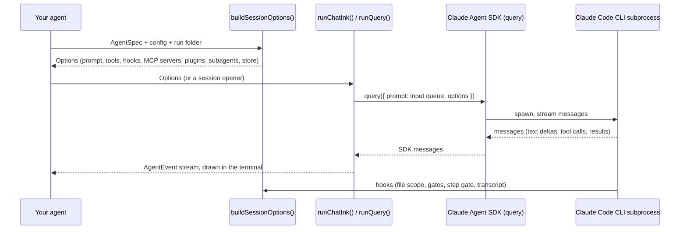

# Arquitectura

## El flujo {#the-flow}

1. **Tu agente** implementa una [`AgentSpec`](agent-spec.md) y construye una [configuración](session-config.md).
2. **[`buildSessionOptions()`](session-options.md)** las convierte en las `Options` del SDK: el prompt del sistema, las herramientas que concede la configuración, los servidores MCP propios del kit (aprobaciones, intervención manual, guardar en las fuentes), los hooks de seguridad, los plugins y los subagentes.
3. **Un ejecutor** arranca la sesión: `runChatInk()` o `runChatTui()` para una conversación, [`runQuery()`](../advanced/events.md) para todo lo demás. Envuelven el `query()` del SDK.
4. **El SDK** ejecuta el CLI de Claude Code como subproceso. El CLI llama al modelo, ejecuta las herramientas y llama a los hooks del kit antes y después de cada llamada a herramienta.
5. **`runQuery()`** convierte el flujo de mensajes en bruto del SDK en un conjunto pequeño de [`AgentEvent`](../advanced/events.md), que la interfaz de terminal dibuja o que tu propio host reenvía.

## Dos capas {#two-layers}

El kit está dividido para que el mismo agente pueda ejecutarse en un terminal o dentro de otro programa:

| Capa | Carpeta | Regla | Qué contiene |
| --- | --- | --- | --- |
| Núcleo | `src/core/` | Nunca toca `console`, `process.stdout` ni `readline` | `AgentSpec`, `buildSessionOptions()`, `runQuery()`, los hooks, las herramientas MCP propias del kit (aprobaciones, el reloj), las ejecuciones, los idiomas, el puerto de interacción, la interfaz de las extensiones |
| Extensiones | `src/extensions/<name>/`, con su plugin en `extensions/<name>/` | Como el núcleo, sin terminal; importan el núcleo, nunca unas a otras, y el núcleo nunca las importa, ni siquiera sus tipos (una regla de ESLint lo garantiza) | Las cuatro del kit, cada una una factoría con sus propias opciones (`awareness()`, `sources({ dir })`, `knowledge({ dir })`, `memory({ dir })`): sus herramientas, su sección del prompt y sus datos, que `buildSessionOptions()` reúne cuando la spec las activa |
| Interfaz de terminal | `src/tui/` | El único código que da por hecho un terminal | El chat Ink, el chat sencillo, la vista de progreso, el asistente, `ensureClaudeAuth()`, el puerto de interacción del terminal, la paleta y los temas |

Todas se exportan desde la raíz del paquete; nada obliga a una aplicación de escritorio a cargar el código de la interfaz de terminal, y nada en el núcleo imprime nada. Un punto de control (una aprobación, por ejemplo) llega a la persona a través de un [`InteractionPort`](../human-in-the-loop/interaction-port.md): el terminal instala el suyo por defecto y una aplicación de escritorio instala uno que abre un diálogo.

## Piezas clave {#key-pieces}

| Pieza | Tipo | Página |
| --- | --- | --- |
| `AgentSpec<TConfig>` | interfaz que implementas | [AgentSpec](agent-spec.md) |
| `BaseSessionConfig` | configuración que amplías | [Configuración de la sesión](session-config.md) |
| `Mode` | `"interactive" \| "guided" \| "autonomous"` | [Modos](modes.md) |
| `buildSessionOptions()` | construye las `Options` del SDK | [Opciones de la sesión](session-options.md) |
| `createInputQueue()` | la entrada multiturno de un chat | [Eventos](../advanced/events.md) |
| `runQuery()`, `AgentEvent` | el flujo de eventos normalizado | [Eventos](../advanced/events.md) |
| `runChatInk()`, `runChatTui()` | chats | [Chat Ink](../terminal-ui/ink-chat.md), [Chat sencillo](../terminal-ui/plain-chat.md) |
| `createProgressView()`, `createConsoleRenderer()` | ejecuciones de una sola vez | [Vista de progreso](../terminal-ui/progress-view.md) |
| `runWizard()` | preguntas antes de que arranque el agente | [Asistente](../terminal-ui/wizard.md) |
| `InteractionPort`, `askForDecision()` | persona en el bucle | [Puerto de interacción](../human-in-the-loop/interaction-port.md) |
| `createRunStore()`, `listRuns()` | conversaciones guardadas en carpetas de ejecución | [Ejecuciones y reanudación](../sessions/runs-and-resuming.md) |
| `setLanguage()`, `setTheme()` | el idioma y los colores del proceso | [Idiomas](../sessions/languages.md), [Temas](../terminal-ui/themes.md) |

## Principios de diseño que notarás {#design-principles-youll-notice}

- **Nada específico de un dominio en el kit.** Los agentes aportan su dominio a través de `AgentSpec` y de su propio tipo de configuración.
- **Las salvaguardas viven en hooks, no en prompts.** Un prompt se puede ignorar; un hook `PreToolUse` que deniega una llamada, no. Consulta [Seguridad](../security/overview.md).
- **Comportamiento del SDK confirmado a mano.** Varias decisiones existen porque el SDK se comporta de maneras que su documentación no cuenta. Están reunidas en [Comportamientos del SDK](../reference/sdk-behaviors.md).
- **Las funcionalidades que conceden Bash son opcionales.** Bash puede llegar a cualquier ruta, así que el kit nunca lo da por defecto y nunca al agente principal.

Las decisiones de diseño están registradas como ADR en el repositorio: [`.minispec/decisions/`](https://github.com/falkenslab/agent-kit/tree/main/.minispec/decisions).
