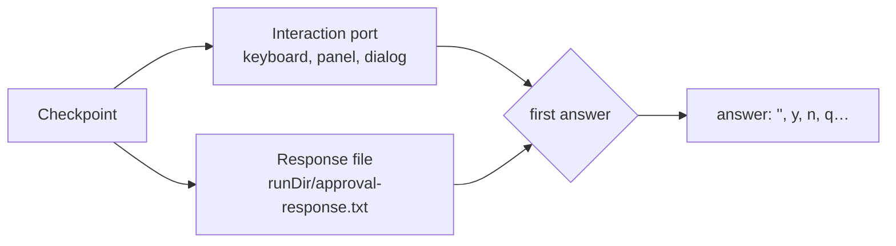

# La persona en el bucle

Un **punto de control** es un momento en que el agente se detiene y espera a una persona. El kit tiene estos tipos:

| Tipo | Lo pregunta | Respuestas | Página |
| --- | --- | --- | --- |
| Decisión | la [puerta de pasos](step-gate.md) (modo interactivo) y la [herramienta de aprobación](approvals.md) (modo guiado) | Sí, No, Parar | [Puerta de pasos](step-gate.md), [Aprobaciones](approvals.md) |
| Intervención manual | la [herramienta de inicio de sesión manual](manual-intervention.md) | Hecho, continuar | [Intervención manual](manual-intervention.md) |
| Elección | `ask_human`, y `present_plan` en modo plan | Una o varias opciones, o palabras propias | [Elecciones y planes](choices-and-plans.md) |
| Texto | `request_file` | Una ruta, o nada | [Fuentes](../capabilities/knowledge-base.md#adding-originals) |
| Formulario, o una página que abrir | un servidor MCP, en mitad de una herramienta (elicitación) | Sus valores, o rechazado, o cancelado; la respuesta va al servidor, no al modelo | [Servidores que preguntan a la persona](elicitation.md) |

Tus propias herramientas y hooks también pueden preguntar, con las mismas funciones: [`askForDecision()`](#asking-from-your-own-code), `askForManualIntervention()`, [`askForChoice()`](choices-and-plans.md#asking-from-your-own-code) y `askForText()`.

## Dos canales: gana la primera respuesta {#two-channels-first-answer-wins}

Cada punto de control se pregunta por dos canales a la vez:

1. **El puerto de interacción**: el terminal, un panel en la interfaz de Ink o un diálogo en tu propia aplicación. Consulta [Puerto de interacción](interaction-port.md).
2. **El fichero de respuesta**: `<runDir>/approval-response.txt`. Cualquier otra cosa (un script, otro programa, Claude Code manejando el agente) responde escribiendo en él. Consulta [Fichero de respuesta](response-file.md).



Cuando un canal responde, el otro se cancela: la pregunta del puerto se retira (el panel se cierra, con una nota de que se respondió a través del fichero) y el fichero se borra.

Un puerto que no puede preguntar (sin TTY, sin ventana) simplemente nunca responde, así que gana el fichero. Un agente que se ejecuta en segundo plano sigue funcionando: espera al fichero.

## Cómo son los paneles {#what-the-panels-look-like}

En el chat de Ink, una decisión es un panel con borde, con el título y los detalles de la pregunta, y opciones numeradas:

```text
╭──────────────────────────────────────────────────────────────╮
│ Human confirmation required before publishing                │
│ Summary: post the weekly summary in the course forum         │
│                                                              │
│ Do you want to proceed?                                      │
│ ❯ 1. Yes                                                     │
│   2. No                                                      │
│   3. Stop                                                    │
╰──────────────────────────────────────────────────────────────╯
```

- Responden ↑/↓ y Enter, los dígitos `1`-`3`, o `y`, `n`, `q`.
- Ctrl+C responde **Stop** e interrumpe el turno.
- El resultado queda en el historial (`✔ Approved`, `✘ Rejected`, `■ Stopped`).

Las vistas previas largas (una puerta de pasos que muestra un fichero entero como parámetro de una herramienta) se recortan para que quepan en el terminal. Sustituye la vista previa por tu propia representación con la opción `renderApproval` del chat (consulta [Chat de Ink](../terminal-ui/ink-chat.md#approval-panels)).

En el chat sencillo y sin Ink, el punto de control se imprime como `=== Title ===`, las líneas y una pregunta (`Allow this to continue? [Y/n/q]`).

## Preguntar desde tu propio código {#asking-from-your-own-code}

`askForDecision(runDir, prompt)` y `askForManualIntervention(runDir, prompt)` hacen competir el puerto y el fichero de respuesta exactamente igual que los puntos de control del kit, y se resuelven con la respuesta en minúsculas y sin espacios alrededor:

```ts
import { askForDecision, createSdkMcpServer, tool } from "@falkenslab/agent-kit";
import { z } from "zod";

function createRefundServer(runDir: string) {
  return createSdkMcpServer({
    name: "billing",
    version: "1.0.0",
    tools: [
      tool(
        "refund",
        "Refund an order. A person always confirms it first.",
        { orderId: z.string(), amount: z.number() },
        async ({ orderId, amount }) => {
          const answer = await askForDecision(runDir, {
            title: "Refund",
            lines: [`Order: ${orderId}`, `Amount: ${amount.toFixed(2)} €`],
          });
          if (answer !== "" && answer !== "y" && answer !== "yes") {
            return { content: [{ type: "text" as const, text: "The refund was not approved." }], isError: true };
          }
          await billing.refund(orderId, amount);
          return { content: [{ type: "text" as const, text: `Refunded ${amount.toFixed(2)} € for ${orderId}.` }] };
        },
      ),
    ],
  });
}

// buildMcpServers: (config, runDir) => ({ billing: createRefundServer(runDir) }),
```

A diferencia de la herramienta de aprobación, esta confirmación no depende de que el modelo decida preguntar: la herramienta siempre pregunta, en todos los modos.
