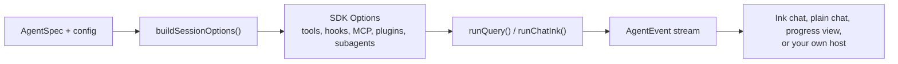

# agent-kit

`@falkenslab/agent-kit` es un andamiaje para construir agentes sobre el [Claude Agent SDK](https://www.npmjs.com/package/@anthropic-ai/claude-agent-sdk) (`@anthropic-ai/claude-agent-sdk`). No es un agente: resuelve una sola vez lo que todo agente necesita, de modo que un agente concreto solo escribe lo que pertenece a su propio dominio.

## Qué le da el kit a un agente {#what-the-kit-gives-an-agent}

| Área | Qué obtienes |
| --- | --- |
| Supervisión | Cuatro modos: `autonomous`, `guided` (una aprobación antes de cualquier cosa visible o difícil de deshacer), `interactive` (una aprobación antes de cada llamada a una herramienta) y `plan` (solo leer y planificar hasta que la persona lo abandone). Todos menos el autónomo se pueden cambiar entre sí en caliente. |
| Persona en el bucle | Puntos de control de aprobación y de intervención manual, respondidos desde el teclado, desde un panel de la interfaz Ink, desde una aplicación de escritorio a través de un `InteractionPort` o escribiendo un fichero de respuesta. |
| Seguridad | Hooks que mantienen las herramientas de ficheros dentro de las carpetas del propio agente, protegen rutas, reservan Bash solo para los subagentes, permiten únicamente los subagentes que declaras y los ejecutan en primer plano. |
| Memoria | Una base de conocimiento integrada (una "wiki LLM" que el propio agente mantiene), los originales guardados intactos en una carpeta de fuentes, una memoria de la persona a lo largo de todos sus proyectos y cada conversación guardada en la carpeta de su ejecución para reanudarla más tarde. |
| Awareness | El agente sabe quién es y qué es en este momento (su modo, sus extensiones y sus herramientas, sus subagentes, sus comandos, su contexto), y cómo se usa su chat, así que la persona puede preguntárselo. |
| Herramientas | Tus propios servidores MCP (en proceso o externos), skills y comandos slash en plugins, y subagentes. |
| Interfaz de terminal | Un chat Ink a pantalla completa inspirado en Claude Code, un chat readline sencillo, una vista de progreso para ejecuciones de una sola vez y un asistente (wizard) de preguntas, con temas y cuatro idiomas. |
| Hosts | Un núcleo que nunca toca el terminal, un flujo de eventos normalizado (`runQuery()`) y puertos para que una aplicación de escritorio o un servidor puedan manejar el mismo agente. |
| Rastro | Un registro de sesión con lo que mostró el terminal y una transcripción de cada llamada a herramienta con los secretos ocultos. |

## Qué escribe el propio agente {#what-an-agent-writes-itself}

Un agente implementa un contrato pequeño, [`AgentSpec`](core-concepts/agent-spec.md): su prompt del sistema, los servidores MCP que siempre tiene, las carpetas con sus skills y comandos, y sus subagentes. Todo lo demás es configuración:

- un objeto de configuración ([`BaseSessionConfig`](core-concepts/session-config.md), ampliado con los campos propios del agente) con el modo y las carpetas en las que trabaja;
- las opciones de la interfaz que quiera (una cabecera, un mensaje de bienvenida, un tema, sus propios textos).

`buildSessionOptions()` convierte la spec y la configuración en las `Options` del SDK para `query()`, y un chat o una vista de progreso ejecuta la sesión.

## Cómo está organizada esta documentación {#how-this-documentation-is-organized}

1. **[Primeros pasos](getting-started/installation.md)**: instala el kit, autentícate y construye un primer agente paso a paso.
2. **[Conceptos básicos](core-concepts/architecture.md)**: la arquitectura, `AgentSpec`, la configuración de la sesión, los modos y qué construye exactamente `buildSessionOptions()`.
3. **[Capacidades](capabilities/tools-and-mcp.md)**: herramientas y servidores MCP, skills y plugins, subagentes, la base de conocimiento y los ficheros de prompt.
4. **[Persona en el bucle](human-in-the-loop/overview.md)**: puntos de control, el fichero de respuesta y puertos de interacción a medida.
5. **[Seguridad](security/overview.md)**: cada salvaguarda y por qué existe.
6. **[Interfaz de terminal](terminal-ui/ink-chat.md)**: los chats, la vista de progreso, el asistente, las etiquetas de las herramientas y los temas.
7. **[Sesiones](sessions/runs-and-resuming.md)**: carpetas de ejecución y reanudación, idiomas, tamaño del contexto y coste.
8. **[Avanzado](advanced/events.md)**: el flujo de eventos, las ejecuciones de una sola vez, los hosts sin terminal y tus propios hooks.
9. **[Ejemplos](examples/captain-whiskers.md)**: Captain Whiskers, fichero a fichero, y recetas cortas.
10. **[Referencia](reference/sdk-behaviors.md)**: comportamientos del SDK en los que se apoya el kit, resolución de problemas y versionado.
11. **[Referencia de la API](api/index.md)**: cada export, generado a partir del código fuente.

:::info Requisitos
Node.js 20 o posterior, y un token de suscripción de Claude o una clave de API de Anthropic. El kit es solo ESM y está escrito en TypeScript; sus declaraciones de tipos vienen con el paquete.
:::
